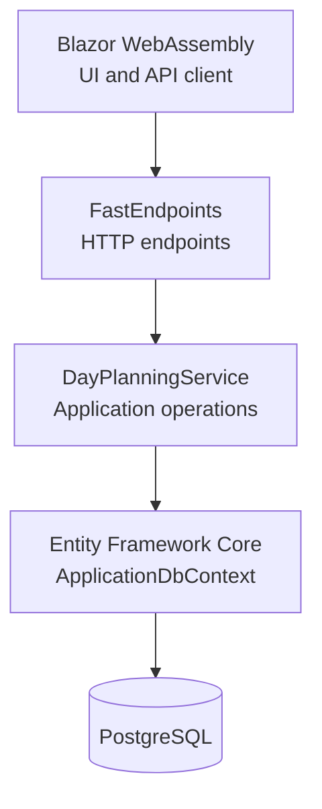

# Architecture

## Architecture Overview

Daily Planner is a .NET 10 web application consisting of a Blazor WebAssembly frontend, an ASP.NET Core backend, and a PostgreSQL database.

The application follows a client-server architecture. The server hosts the frontend and exposes a same-origin HTTP API built with FastEndpoints. API requests are handled by application services, which use Entity Framework Core to interact with PostgreSQL.

The solution is organized into separate projects for the user interface, API, application logic, domain models, data persistence, and shared contracts. This separation keeps responsibilities explicit, although the implementation does not strictly follow a dependency-inversion or Clean Architecture model.

## Solution Structure

The solution is divided into six projects, each with a distinct responsibility.

| Project | Responsibility |
|---|---|
| [`Planning.Client`](../src/Planning.Client/) | Blazor WebAssembly pages and components, browser authentication state, and API clients. |
| [`Planning.Server`](../src/Planning.Server/) | ASP.NET Core application hosting, FastEndpoints API endpoints, authentication, authorization, and HTTP response handling. |
| [`Planning.Shared`](../src/Planning.Shared/) | Shared API request and response contracts, identity role definitions, and selected validators. |
| [`Planning.Services`](../src/Planning.Services/) | Application operations for daily planning, user-specific data access, and default time block initialization. |
| [`Planning.Domain`](../src/Planning.Domain/) | Domain entities and business rules, including constraints on planned activities. |
| [`Planning.Persistence`](../src/Planning.Persistence/) | EF Core database context, entity mappings, migrations, persistence triggers, and development data seeding. |

This structure separates the user interface, HTTP handling, application operations, and data persistence into dedicated projects. Shared contracts support communication between the client and server, while domain entities represent the core planning data and rules.

## Request and Data Flow

Daily planning operations follow a consistent flow from the Blazor WebAssembly frontend through the API and application services to the database.

When a user interacts with the day planning page, the Blazor frontend sends an HTTP request to the `/api/day-planning` endpoints using shared request and response contracts.

FastEndpoints handles the incoming request and delegates planning operations to `DayPlanningService`. The service identifies the current user, performs the required operations, and accesses PostgreSQL through Entity Framework Core.

For example, retrieving a day plan involves loading the user's time blocks and activities for the selected date, then organizing the activities under their corresponding time blocks.

The API converts the service result into an HTTP response. The frontend processes the response and updates the displayed planning information.

## Authentication and Authorization

Daily Planner uses ASP.NET Core Identity with cookie-based authentication. User accounts and roles are stored in PostgreSQL through Entity Framework Core.

After signing in, the browser uses the authentication cookie for subsequent API requests. The Blazor WebAssembly client retrieves the current user's authentication information from the server to maintain its authentication state.

API endpoints enforce authentication and, where applicable, role-based authorization. Planning operations also verify the current user's identity and restrict access to their own time blocks and activities.

Registration initializes six default time blocks for the new user within a database transaction.

## Data Persistence

Daily Planner uses PostgreSQL for data storage, with Entity Framework Core (EF Core) handling database access and entity mapping.

The `ApplicationDbContext` manages both planning data and ASP.NET Core Identity tables.

The planning data model consists of three main entities:

| Entity | Description |
|---|---|
| `Activity` | Represents a reusable activity that can be linked to planned activities. |
| `TimeBlock` | Represents a user-specific time block used to organize the day. |
| `PlannedActivity` | Represents an activity scheduled for a specific date and time block, including its completion and importance status. |

Planning entities are associated with individual users through a `UserId`. Database relationships and constraints help maintain data integrity, including ensuring that a planned activity references a time block belonging to the same user.

EF Core migrations manage database schema changes. In the `Development` environment, migrations are applied automatically and sample data is created during application startup.

## Validation and Error Handling

Daily Planner implements validation at multiple levels to ensure data integrity and provide clear feedback to users.

### Validation

- **Client-side:** Blazor forms use Data Annotations to provide immediate feedback on invalid input.
- **API:** FastEndpoints uses FluentValidation to validate incoming requests before they reach the application services.
- **Application and domain:** Business rules enforce constraints such as activity name and description limits. Application services also verify that referenced time blocks belong to the current user.

### Error Handling

The API uses a consistent error response format based on `application/problem+json`. Validation failures, authorization errors, missing resources, and unexpected API exceptions are handled through a centralized response mechanism.

The Blazor client interprets these responses and displays relevant error messages, including field-specific validation errors where available.

For more details, see the [API Error Contract](api-errors.md).

## Testing Architecture

Daily Planner uses automated tests at multiple levels to verify domain rules, application behavior, API interactions, and user workflows.

The test suite is organized into five projects:

| Test Project | Scope |
|---|---|
| [`Planning.Domain.Tests`](../tests/Planning.Domain.Tests/) | Tests domain entities and business rules. |
| [`Planning.Services.Tests`](../tests/Planning.Services.Tests/) | Tests application services using temporary PostgreSQL databases provided by Testcontainers. |
| [`Planning.Server.Tests`](../tests/Planning.Server.Tests/) | Tests API endpoints, authentication, and error handling using `WebApplicationFactory`. |
| [`Planning.Client.Tests`](../tests/Planning.Client.Tests/) | Tests Blazor components using bUnit, as well as client-side API response handling and authentication state. |
| [`Planning.E2E.Tests`](../tests/Planning.E2E.Tests/) | Uses Playwright to test complete user workflows in a browser against a running application and temporary database. |

This approach combines focused tests of individual components with integration and end-to-end tests that verify how different parts of the application work together.

For instructions on running the tests locally, see the [Development & Testing](../README.md#development--testing) section in the README.

