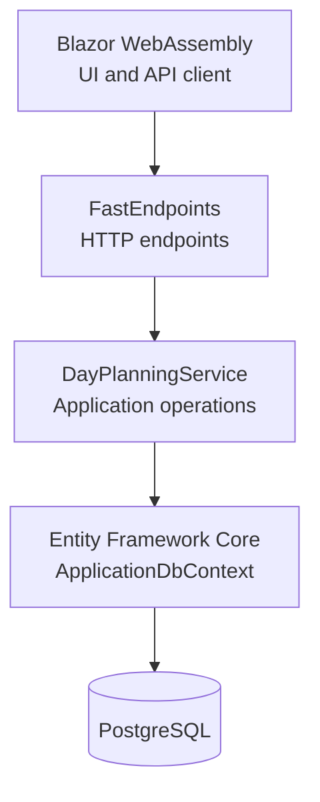

# Architecture

## Architecture Overview

Daily Planner is a .NET 10 web application consisting of a Blazor WebAssembly frontend, an ASP.NET Core backend, and a PostgreSQL database.

The application follows a client-server architecture. The server hosts the frontend and exposes a same-origin HTTP API built with FastEndpoints. API requests are handled by application services, which use Entity Framework Core to interact with PostgreSQL.

The solution is organized into separate projects for the user interface, API, application logic, domain models, data persistence, and shared contracts. This separation keeps responsibilities explicit, although the implementation does not strictly follow a dependency-inversion or Clean Architecture model.

## Solution Structure

The solution is divided into six projects, each with a distinct responsibility.

| Project | Responsibility |
|---|---|
| [`Planning.Client`](../src/Planning.Client/) | Blazor WebAssembly pages and components, browser authentication state, and API clients. |
| [`Planning.Server`](../src/Planning.Server/) | ASP.NET Core application hosting, FastEndpoints API endpoints, authentication, authorization, and HTTP response handling. |
| [`Planning.Shared`](../src/Planning.Shared/) | Shared API request and response contracts, identity role definitions, and selected validators. |
| [`Planning.Services`](../src/Planning.Services/) | Application operations for daily planning, user-specific data access, and default time block initialization. |
| [`Planning.Domain`](../src/Planning.Domain/) | Domain entities and business rules, including constraints on planned activities. |
| [`Planning.Persistence`](../src/Planning.Persistence/) | EF Core database context, entity mappings, migrations, persistence triggers, and development data seeding. |

This structure separates the user interface, HTTP handling, application operations, and data persistence into dedicated projects. Shared contracts support communication between the client and server, while domain entities represent the core planning data and rules.

## Request and Data Flow

Daily planning operations follow a consistent flow from the Blazor WebAssembly frontend through the API and application services to the database.

When a user interacts with the day planning page, the Blazor frontend sends an HTTP request to the `/api/day-planning` endpoints using shared request and response contracts.

FastEndpoints handles the incoming request and delegates planning operations to `DayPlanningService`. The service identifies the current user, performs the required operations, and accesses PostgreSQL through Entity Framework Core.

For example, retrieving a day plan involves loading the user's time blocks and activities for the selected date, then organizing the activities under their corresponding time blocks.

The API converts the service result into an HTTP response. The frontend processes the response and updates the displayed planning information.

## Authentication and authorization

The server configures ASP.NET Core Identity with EF Core stores and authentication/authorization middleware in [`Program.cs`](../src/Planning.Server/Program.cs). Login uses `SignInManager` with the Identity application cookie; logout signs out. In the browser, the named `SecureApi` HTTP client uses [`CookieHandler`](../src/Planning.Client/Identity/CookieHandler.cs) to include browser credentials. [`CookieAuthenticationStateProvider`](../src/Planning.Client/Identity/CookieAuthenticationStateProvider.cs) calls the account-info endpoint and builds the Blazor principal from returned claims and roles.

Registration and login allow anonymous requests. Other FastEndpoints endpoints use the framework's default authorization behavior unless configured otherwise; role management endpoints explicitly require the `Administrator` role. The client has authorized example routes, while the day planning page itself has no `[Authorize]` attribute. Regardless of client routing, the planning service requires a current user ID and scopes its time block and planned activity queries to that user. See the [planning endpoints](../src/Planning.Server/Endpoints/DayPlanning/), [role endpoints](../src/Planning.Server/Endpoints/Identity/Roles/), and [planning service](../src/Planning.Services/DayPlanning/DayPlanningService.cs).

## Data persistence

[`ApplicationDbContext`](../src/Planning.Persistence/ApplicationDbContext.cs) derives from `IdentityDbContext<IdentityUser>` and exposes `Activity`, `TimeBlock`, and `PlannedActivity` sets alongside Identity tables. EF Core mappings in [`Configurations`](../src/Planning.Persistence/Configurations/) define relationships, constraints, and indexes. `PlannedActivity` stores a date, time block, name, description, completion flag, and importance flag; it also has an optional link to `Activity`. The planning workflow currently creates and edits planned activities directly.

User ownership is represented by `UserId` on planning entities. The planned activity mapping uses a composite foreign key from `(TimeBlockId, UserId)` to a time block's `(Id, UserId)`, and indexes `(UserId, Date)`. Default time blocks are stored per user, rather than calculated only in the UI. See the [entity mappings](../src/Planning.Persistence/Configurations/PlannedActivities/PlannedActivityConfiguration.cs) and [initializer](../src/Planning.Services/TimeBlocks/DefaultTimeBlockInitializer.cs).

The common entity base has timestamps and an `IsDeleted` flag. A [before-save trigger](../src/Planning.Persistence/Triggers/EntityBeforeSaveTrigger.cs) updates timestamps and converts tracked EF deletion into a soft delete. The current planning service's delete operation instead uses `ExecuteDeleteAsync`, which deletes the database row directly and bypasses that trigger. Planning reads filter out rows marked as deleted. In `Development`, server startup applies [EF Core migrations](../src/Planning.Persistence/Migrations/) and seeds demo accounts and planning data; the startup code does not run that migration and seeding block in other environments.

## Validation and error handling

The activity form uses a local model with data annotations for immediate browser validation. FastEndpoints uses FluentValidation for planning create/update requests and the validators defined in shared identity request types. [`PlannedActivityRules`](../src/Planning.Domain/PlannedActivities/PlannedActivityRules.cs) supplies the planning text limits used by the API validators and domain entity. The service also checks those limits and verifies that a requested time block belongs to the current user before saving. See the [form model](../src/Planning.Client/DayPlanning/ActivityFormModel.cs), [endpoint validators](../src/Planning.Server/Endpoints/DayPlanning/), and [service](../src/Planning.Services/DayPlanning/DayPlanningService.cs).

The API maps application results, validation failures, authorization failures, missing API routes, and unhandled API exceptions to `application/problem+json` responses. Validation errors can include field names and reasons. The browser response reader turns those errors into client results, which the form can display. The error contract is described separately in [API errors](api-errors.md); the implementation is in [`ApiProblemResponse`](../src/Planning.Server/Errors/ApiProblemResponse.cs), [`GlobalResponseSender`](../src/Planning.Server/Processors/GlobalResponseSender.cs), and the [client response reader](../src/Planning.Client/Http/ApiResponseReader.cs). Server request and response processors use Serilog for API logging.

## Testing architecture

The solution has separate [domain](../tests/Planning.Domain.Tests/), [service](../tests/Planning.Services.Tests/), [server](../tests/Planning.Server.Tests/), [client](../tests/Planning.Client.Tests/), and [end-to-end](../tests/Planning.E2E.Tests/) test projects. Domain tests exercise entity rules. Service tests exercise planning operations against temporary PostgreSQL instances via Testcontainers. Server tests use `WebApplicationFactory` to verify endpoint, identity, and error behavior; planning endpoint tests can replace the planning service with a test implementation. Client tests use bUnit for components and test the API response reader and authentication state provider. Playwright end-to-end tests run the hosted application with a temporary database and exercise browser planning journeys. These are the test layers present in the repository, rather than a guarantee of coverage for every behavior.
